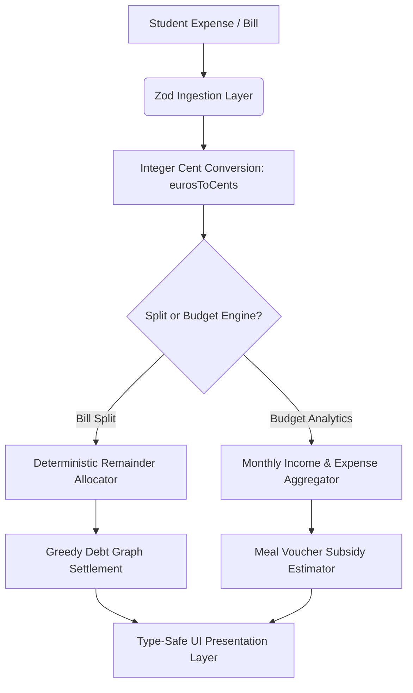

<div align="center">

# 💶 Študentski Denar

**Precision Student Financial Intelligence & Deterministic Bill-Splitting Engine**

[](https://github.com/flegartech-mvp/studentski-denar/actions)
[](https://www.typescriptlang.org/)
[](https://opensource.org/licenses/MIT)
[](https://vitest.dev/)
[](https://github.com/flegartech-mvp/studentski-denar)

[**Live Demo**](https://denar.flegartech.com) • [**API Documentation**](https://docs.denar.flegartech.com) • [**Report Bug**](https://github.com/flegartech-mvp/studentski-denar/issues)

</div>

---

## 📌 Executive Summary

**Študentski Denar** is an open-source student financial management system engineered specifically for European student demographics. It features exact integer-cent accounting to eliminate floating-point rounding errors, an unfair-proof bill splitting engine with greedy peer-to-peer settlement minimization, and specialized tracking for subsidized student meal vouchers (*Študentska Prehrana / Boni*).

---

## 🎯 Target Persona & Real-World Use Cases

- **University Students & Flatmates:** Track shared apartment utilities, grocery runs, and dorm expenses with mathematically fair, zero-remainder splits.
- **Student Workers (*Študentsko Delo*):** Project net take-home earnings against concessions and scholarships.
- **Budget-Conscious Diners:** Maximize monthly food savings by monitoring used vs. remaining student meal vouchers and state subsidies.

---

## 🚀 Live Demo & Interactive Preview

| Fair Bill Split Engine | Monthly Student Budgeting |
| :---: | :---: |
| [](https://denar.flegartech.com) | [▶ Open Live Sandbox](https://denar.flegartech.com/budget) |

---

## ⚡ Key Engineering Highlights

- **Exact Integer Arithmetic (`MoneyCents`):** All financial values are modeled in integer cents to completely avoid IEEE-754 floating-point drift (e.g. `0.1 + 0.2 !== 0.3`).
- **Deterministic Remainder Conservation:** In fractional division (e.g. splitting €10.00 among 3 people), residual cents are distributed deterministically by fractional priority so that \(\sum \text{shares} = \text{total}\).
- **Greedy Debt Graph Minimizer:** Reduces \(O(N^2)\) bilateral debts into a minimal list of direct peer-to-peer bank transfers.
- **Student Subsidy Tracking:** Integrates Slovenian student meal voucher (*Študentski boni*) value formulas and monthly quota forecasting.

---

## 🏗️ System Architecture & Data Pipeline



---

## 🛠️ Quickstart & Local Development

### Prerequisites
- Node.js `20.x` or higher
- `pnpm` `9.x` (recommended) or `npm`

### Installation & Execution

```bash
# 1. Clone the repository
git clone https://github.com/flegartech-mvp/studentski-denar.git
cd studentski-denar

# 2. Install dependencies
pnpm install

# 3. Configure environment variables
cp .env.example .env

# 4. Start local development server
pnpm dev

# 5. Run automated test suite
pnpm test

# 6. Typecheck & linting verification
pnpm typecheck
```

---

## 🧪 Testing & Quality Assurance

```bash
pnpm test:coverage
```

Our Vitest test suite rigorously validates:
- Indivisible remainder balancing across arbitrary group sizes (3, 7, 13 participants)
- Positive, zero, and negative balance settlements
- Category summation integrity and monthly savings rates
- Zod schema validation against negative amounts or corrupted transaction records

---

## 📄 License & Contributing

Distributed under the **MIT License**. Contributions and localization extensions are encouraged!
